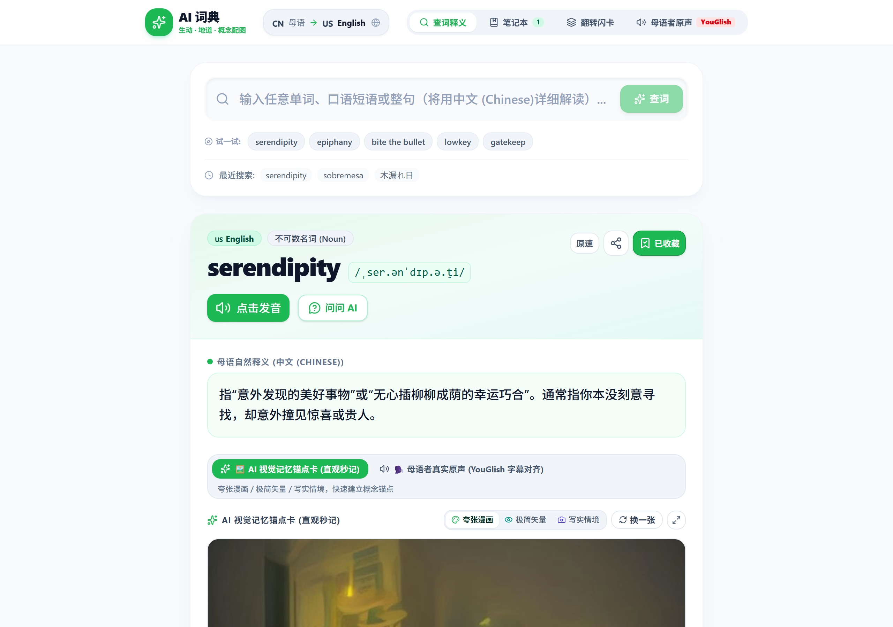
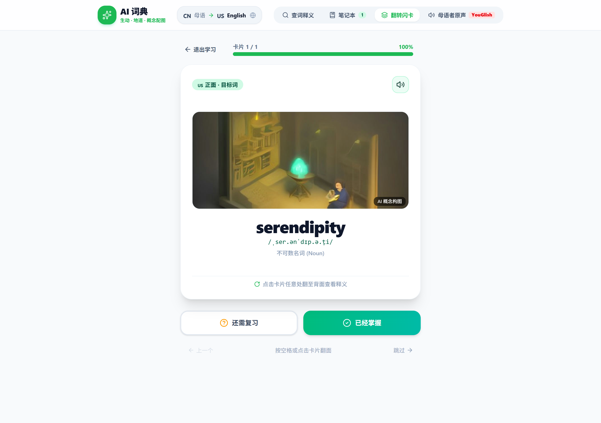

# 🌟 LingoLens | AI 视觉记忆智能词典

<div align="center">

<p align="center">
  
</p>

[](https://react.dev/)
[](https://www.typescriptlang.org/)
[](https://tailwindcss.com/)
[](https://ai.google.dev/)
[](https://web.dev/progressive-web-apps/)
[](LICENSE)

<p align="center">
  <strong>将抽象词汇与俗语，转化为过目不忘的视觉记忆锚点与地道文化语境</strong><br>
  <em>Transform abstract idioms, slang, and vocabulary into unforgettable visual mental hooks with contextual AI.</em>
</p>

[📸 界面预览](#-界面预览-screenshots) •
[🧠 产品思考](#-产品思考与取舍-product-trade-offs) •
[✨ 核心特性](#-核心亮点-highlights) •
[📱 手机/桌面安装 (PWA)](#-跨端体验--pwa-安装指南) •
[🚀 快速开始](#-本地运行指南-quick-start) •
[🏗️ 系统架构](#-技术架构-architecture)

</div>

---

## 📸 界面预览 (Screenshots)

| 首页与语境查词入口 | 视觉记忆锚点卡（概念插画＋文化语境） | 3D 翻转闪卡与闭环复习 |
| :---: | :---: | :---: |
|  |  |  |

---

## 🧠 产品思考与取舍 (Product Trade-offs)

- **为什么要做**：传统电子词典只给静态释义，对文化隐喻强的习语（如 *bite the bullet*）记忆效率低。结合教育学与认知心理学中的**双重编码理论（Dual-Coding Theory）**，本项目尝试用「专属视觉隐喻＋母语好友式语境＋3D 闪卡＋生词串联故事」构建完整记忆闭环。
- **刻意做的架构与成本取舍**：① 针对高频习语内置本地 `curatedBank.ts`（0ms 响应、零 API 消耗），叠加前后端双层内存缓存，控制大模型调用延迟与费用；② 后端实现多模型自动冷却与超时熔断降级（3.5s 竞速超时），减少单一模型 429/503 抖动带来的体验中断。
- **诚实的当前边界**：这是一个**个人独立完成的 AI 全栈交互原型（Prototype）**，目前使用浏览器本地存储（LocalStorage）而非云端账户体系，尚未经过大规模商业并发压测；下一步计划是邀请小批真实学习者试用，根据反馈迭代提示词与复习节奏。

---

## 💡 为什么需要 LingoLens？

传统词典往往只提供枯燥的字典定义与刻板例句，死记硬背效率极低；当遇到 **"bite the bullet"**、**"couch potato"**、**"破防"**、**"一期一会"** 等带有强烈文化色彩或抽象意象的表达时，大脑难以产生直观共鸣。

**LingoLens** 运用 **认知心理学中的双重编码理论 (Dual-Coding Theory)**，将每一次查词重构为多维度的沉浸式体验：
1. **视觉具象化**：AI 针对词条定制概念隐喻与动态插画（美漫、二次元、水彩、波普等多种艺术风格自由切换）。
2. **好友式地道语境**：抛弃机械教条，像当地母语朋友一样为你拆解调侃语气、文化出处与真实生活痛点。
3. **闭环记忆系统**：生词笔记本、3D 翻转闪卡背诵、AI 自动串联生词创作情境故事、1对1 伴学 AI 助教。

---

## ✨ 核心亮点 (Highlights)

```
       🔍 视觉语义检索 (Instant Lookup)
                      │
   ┌──────────────────┴──────────────────┐
   ▼                                     ▼
🖼️ 概念图像与记忆锚点              🗣️ 好友级地道语境
• 视觉隐喻 (Visual Metaphor)        • 文化渊源 (Cultural Vibe)
• 风格换肤 (Comic/Anime/Art)         • 真实场景 (Real Scenarios)
• 画面聚焦记忆线索 (Focal Points)    • 语气调性与近义辨析
   │                                     │
   └──────────────────┬──────────────────┘
                      ▼
            📚 闭环记忆工作流 (Memory Flow)
   ┌──────────────────┼──────────────────┐
   ▼                  ▼                  ▼
📒 生词记事本       🃏 3D 翻转闪卡       📖 AI 串联记忆故事
(Smart Notebook)   (Interactive Cards)  (Context Narrative)
```

### 1. 🖼️ AI 视觉记忆锚点卡 (Visual Memory Hook)
* **概念具象化**：不仅仅是一张图，而是针对词汇内核设计的专属视觉比喻（例如：将 *bite the bullet* 具象为英雄牙齿紧咬闪光金子弹跨越深渊）。
* **多风格渲染**：一键无缝重绘 —— 漫威漫画风、新海诚动漫风、复古水彩风、极简波普风随心选。
* **画面记忆点提示 (Focal Points)**：提炼 3 个关键视觉特征，激活右脑图像记忆。

### 2. 🌍 全球 10 种主流语言双向学习
* 支持 **英语、中文、西班牙语、法语、德语、日语、韩语、阿拉伯语、俄语、葡萄牙语**。
* 内置母语自适应解释系统：无论源语言与目标语言如何搭配，均能用最习惯的母语提供精准自然的翻译。

### 3. 🎙️ 地道语音朗读与语境视频
* 集成高质量发音引擎，支持词汇与双示例句的高保真原声朗读。
* 真实场景视频片段（YouGlish Context）探索，感受真实 Native Speaker 的语调语速。

### 4. 🤖 1对1 词汇互动伴学助教 (Word Chat)
* 查词卡片内置独立抽屉式 AI 聊天：随时向 AI 提问 *“这个词在职场邮件里用合不合适？”*、*“帮我用这个词造两个调侃同事的句子”*，即问即答。

### 5. 📖 生词魔法串联故事 (Story Generator)
* 勾选生词本中的多个词汇，AI 即可根据选定的词条，智能编织一段幽默紧凑的短篇故事，将分散的生词融入连贯生动的情节中。

### 6. ⚡ 毫秒级极速响应与弹性容灾
* **本地高频语料库 (Curated Bank)**：常用习语与例词 0ms 闪电秒开。
* **双层智能内存缓存**：前端 + 后端双重缓存，大幅降低网络开销与 API 消耗。
* **Gemini Flash 故障降级策略**：具备多模型自动冷却切换与 3.5s 超时熔断降级机制，减少单模型拥堵导致的中断。

---

## 📱 跨端体验 & PWA 安装指南

LingoLens 具备完整的渐进式 Web 应用 (PWA) 支持，无需通过应用商店，即可在所有设备上像原生 App 一样全屏无缝使用：

### 🍏 iOS / iPhone / iPad
1. 使用 **Safari 浏览器** 打开部署后的在线网址。
2. 点击屏幕底部的 **分享按钮**（带向上箭头的方形图标）。
3. 向下滚动并选择 **“添加到主屏幕 (Add to Home Screen)”**。
4. 命名为 **“LingoLens”** 并点击添加。
5. 从手机主屏幕启动，即可享受**无浏览器地址栏、全屏手势、流畅如同原生 App** 的体验！

### 🪟 Windows / macOS 桌面端
1. 使用 **Google Chrome** 或 **Microsoft Edge** 访问网址。
2. 点击浏览器地址栏右侧出现的 **“安装”** 图标（显示屏或小方块加号）。
3. 安装完成后，即可直接固定到 Windows 任务栏或 macOS Dock 栏，支持多窗口快捷启动。

---

## 🚀 本地运行指南 (Quick Start)

### 1. 克隆代码仓库
```bash
git clone https://github.com/cyanxjh/lingo-lens.git
cd lingo-lens
```

### 2. 安装依赖
```bash
npm install
```

### 3. 配置环境变量
复制根目录下的 `.env.example` 为 `.env`：
```bash
cp .env.example .env
```
在 `.env` 中填入你的 Gemini API Key（获取地址：[Google AI Studio](https://aistudio.google.com/))：
```env
GEMINI_API_KEY=your_gemini_api_key_here
```

### 4. 启动开发服务器
```bash
npm run dev
```
启动后在浏览器打开 [http://localhost:3000](http://localhost:3000) 即可开始使用。

### 5. 生产构建与打包
```bash
npm run build
npm start
```

---

## 🏗️ 技术架构 (Architecture)

```
lingo-lens/
├── src/                      # 前端客户端 (React 19 + Tailwind CSS v4)
│   ├── components/           # 核心交互组件
│   │   ├── ResultCard.tsx    # 视觉词典结果卡片（配图、例句、语境）
│   │   ├── NotebookView.tsx  # 生词本视图（分类标签、筛选排序）
│   │   ├── FlashcardsView.tsx# 3D 翻转闪卡沉浸式背词
│   │   ├── StoryModal.tsx    # AI 生词串联生成器
│   │   ├── WordChatDrawer.tsx# 词汇 1v1 智能答疑抽屉
│   │   └── AudioButton.tsx   # 原生朗读控制器
│   ├── App.tsx               # 顶层布局控制器与全屏 PWA 适配
│   └── types.ts              # TypeScript 全局数据规范
├── server/                   # 后端能力层
│   └── curatedBank.ts        # 高频词汇与成语离线精选库 (0ms 响应)
├── server.ts                 # Express + Vite SSR 中间件 + Gemini SDK 路由
└── vite.config.ts            # 构建配置与 Tailwind 引擎
```

* **Frontend**: React 19, TypeScript, Tailwind CSS v4, Lucide Icons, Motion
* **Backend**: Node.js, Express, ESBuild Server Bundler
* **AI Engine**: Google `@google/genai` SDK (`gemini-3.1-flash-lite`, `gemini-3.5-flash-lite`)
* **Visual Generator**: Pollinations Flux / SDXL 视觉概念隐喻生成引擎

---

## 🗺️ 产品路线图 (Roadmap)

- [x] 10 种全球主要语言双向即时学习
- [x] 多风格 AI 概念插画与视觉隐喻体系
- [x] 智能生词笔记本与本地 LocalStorage 沉浸保存
- [x] 3D 交互式闪卡模式 (Spaced Repetition)
- [x] AI 故事串联记忆生成器
- [x] PWA 移动端与桌面全屏独立应用适配
- [ ] **v1.1**: 用户账户体系与跨设备云端自动同步 (Firebase / Supabase)
- [ ] **v1.2**: 艾宾浩斯记忆遗忘曲线定时推送复习提醒
- [ ] **v1.3**: 社区记忆卡片广场（点赞与分享趣味记忆法）
- [ ] **v1.4**: 拍照识物直接生成外语视觉卡（视觉多模态输入）

---

## 🤝 参与贡献 (Contributing)

欢迎任何形式的贡献！如果你有任何好的想法、视觉风格建议或发现了 Bug：
1. Fork 本仓库
2. 创建您的新特性分支 (`git checkout -b feature/AmazingFeature`)
3. 提交更改 (`git commit -m 'Add some AmazingFeature'`)
4. 推送到分支 (`git push origin feature/AmazingFeature`)
5. 开启一个 Pull Request

---

## 📄 开源许可 (License)

本项目采用 [MIT License](LICENSE) 开源许可，欢迎个人学习、修改及商业化应用。

<div align="center">
  <sub>Crafted with ❤️ for lifelong language explorers everywhere.</sub>
</div>
